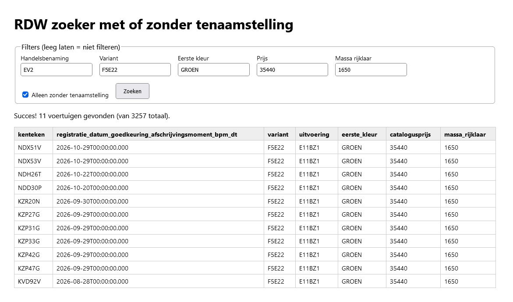

# rdw-zoeker
Zoeken naar kentekens in Nederland m.b.v. RDW API via een lokale HTML pagina. Met filters, met of zonder tenaamstelling.
(Optioneel) filteren op:
 - handelsbenaming
 - variant
 - eerste kleur
 - fiscale waarde inclusief opties af fabriek
 - massa rijklaar

Vooral handig voor diegene die aan het wachten is op een auto en wil weten welke kentekens er al zijn, maar nog niet op naam.
Het mooie is dat je dit lokaal kunt uitvoeren als html pagina.
Pas de defaults aan (in het script zelf of vul in) en klik op zoeken.

Als voorbeeld zijn ingevuld de waardes:
- voor een Kia EV2 (handelsbenaming EV2)
- voor een 5 zits 61 kWh batterij (variant F5E22)
- kleur Morning Haze (eerste kleur GROEN)
- Uitvoering Kia EV2 Plus, Fiscale waarde 34645 euro + Meerprijs exterieurkleuren 795 euro (Prijs 35440)
- Gewicht met 18 inch wielen, leeggewicht 1550 kg + 100 kg (massa rijklaar 1650)

Je zult wel even onderzoek moeten doen naar de variant mogelijkheden, bij de Kia EV2 zijn bijvoorbeeld dit de varianten:
- F4E12: 4-zits, Standard Range (42,2 kWh)
- F4E22: 4-zits, Long Range (61,0 kWh)
- F5E12: 5-zits, Standard Range (42,2 kWh)
- F5E22: 5-zits, Long Range (61,0 kWh)

Voorbeeld:

Sla rdw-zoeker.html op in een html bestand met deze naam en dubbelklik op dit bestand. Eventueel kun je het script binnen het html bestand aanpassen, zodat deze met andere defaults begint.

Je kunt het tool ook direct uitvoeren, [via deze link](https://zuinigerijder.github.io/rdw-zoeker/rdw-zoeker.html)
